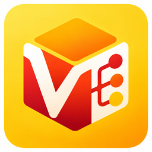
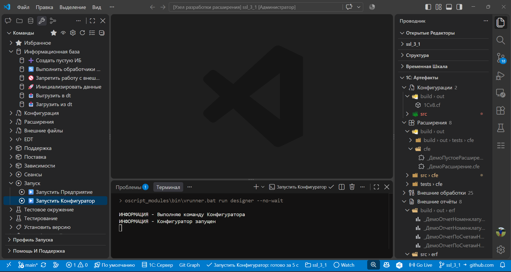

# VSConfigurator

[Репозиторий VSConfigurator](https://github.com/smazovec/vsconfigurator) · [Сообщить о проблеме](https://github.com/smazovec/vsconfigurator/issues)

## Установка VSIX

Сборки этого форка устанавливаются из файла `vsconfigurator-0.9.18.vsix`. В GitHub откройте **Actions → CI → успешный запуск нужного коммита → Artifacts → vsix-<SHA>**, скачайте ZIP и извлеките VSIX (нужен вход в GitHub; срок хранения — 14 дней). Подробности сборки — в [CONTRIBUTING.md](CONTRIBUTING.md#сборка-установочного-пакета).

Для приёмки используйте чистый профиль VS Code: **Profiles → Create Profile → Empty Profile**, затем **Extensions → … → Install from VSIX…**. После установки перезагрузите окно. В списке расширений должны быть имя **VSConfigurator**, новая иконка и идентификатор `smazovec.vsconfigurator` (меню расширения → **Copy Extension ID**). Для CLI: `code --install-extension ./vsconfigurator-0.9.18.vsix`; `code --list-extensions --show-versions` должен содержать `smazovec.vsconfigurator@0.9.18` в выбранном профиле.

`publisher: smazovec` синтаксически допустим для упаковки; наличие и владение publisher в Marketplace не проверены. Публикации этого форка в Marketplace / Open VSX нет в рамках данной задачи.

Внутренние ID `1c-platform-tools.*`, настройки, debug adapter, webview и форматы файлов сохранены. Независимая package identity не гарантирует бесконфликтную одновременную установку с оригиналом. Перенос globalStorage / workspaceState / секретов из исходного расширения не выполняется; VS Code выделяет новому ID собственное хранилище.

Расширение для Visual Studio Code (а также Cursor, Windsurf и VSCodium), которое собирает повседневные инструменты разработки 1С в одном интерфейсе: команды vanessa-runner, навигацию по проектам и артефактам, дерево метаданных, TODO-панель, отладку и интеграцию с AI-агентами. Работает с проектами в формате конфигуратора, 1С:EDT и OneScript.



## Документация

- Руководства исходного проекта по функциям — на сайте [yellow-hammer.github.io/vscode-1c-platform-tools](https://yellow-hammer.github.io/vscode-1c-platform-tools/).
- Знакомство с панелями по шагам — прямо в редакторе: **Help → Welcome → Начало работы с VSConfigurator**.

## Возможности

- **[1С: Инструменты](docs/tools.md)** — дерево команд: информационная база, конфигурация, расширения, внешние файлы, поставка, запуск, тестовое окружение, зависимости, выбор установки OneScript.
- **[1С: Проекты](docs/projects.md)** — проекты окна, их вид и текущий проект; поиск проектов, избранное, теги, переключение через статус-бар и палитру команд.
- **[1С: Администрирование](docs/admin.md)** — список информационных баз платформы и запуск Предприятия или Конфигуратора; консоль кластера через `rac`: подключения к `ras`, сеансы, соединения, блокировки.
- **[1С: Артефакты](docs/artifacts.md)** — дерево `*.cf`/`*.cfe`/`*.epf`/`*.erf` с действиями сборки и разбора.
- **[1С: Метаданные](docs/metadata.md)** — дерево метаданных, свойства и состав объектов, формы, макеты и схемы компоновки, поддержка поставщика, поиск по имени и фильтр по подсистемам.
- **[1С: Свойства](docs/metadata.md#палитра-свойств)** — палитра свойств выделенного узла, как в конфигураторе.
- **[1С: Список дел](docs/todo.md)** — панель меток TODO/FIXME/XXX/HACK/BUG в коде проекта.
- **[Служебные файлы](docs/service-files.md)** — создание из шаблонов: `.gitignore`, `.gitattributes`, профиль запуска, файлы `tools/*`.
- **[Профили запуска](docs/launch-profiles.md)** — параметры подключения к ИБ, активный профиль в статус-баре, своя база на каждую ветку.
- **[Автоматизация](docs/automation.md)** — пайплайны: визуальный редактор цепочек с ветками на успех и ошибку; хуки команд до, после и при ошибке.
- **[Автономный сервер](docs/autonomous-server.md)** — публикация файловой ИБ через `ibsrv`: локальная разработка и отладка HTTP/Web/OData-сервисов, открытие в браузере.
- **[ER-диаграммы](docs/er-diagrams.md)** — интерактивные схемы связей метаданных, экспорт в Mermaid, Draw.io, SVG, PNG.
- **[Тестирование](docs/testing.md)** — панель тестирования VS Code: Vanessa, xUnit, YAxUnit, OneScript и 1bdd, запуск из редактора, статусы и переход к падению; мутационное тестирование через mutatos.
- **[Отладка 1С](docs/debug.md)** — точки останова с условиями, изменение значений переменных, отладка расширений и внешних обработок, замер производительности.
- **[AI-агенты](docs/ai-mcp.md)** — навыки для агентов и запуск команд через файл-триггер.
- **[MCP-сервер](https://yellow-hammer.github.io/vscode-1c-platform-tools/mcp/)** — агент вызывает команды расширения через MCP: установка, подключение, параметры инструментов и примеры фраз.
- **[Docker и ibcmd](docs/docker.md)** — выполнение команд в контейнере без локальной платформы 1С, включая GitHub Codespaces.
- **[Внешние компоненты](docs/components.md)** — отладчик, дерево метаданных, JRE, OVM и Allure: загрузка, свои сборки и работа без доступа к GitHub.
- **[Сочетания клавиш](docs/keyboard.md)** — панели по номеру, синтаксический контроль как в конфигураторе.
- **[Формат EDT](docs/edt.md)** — проекты 1С:EDT наравне с выгрузкой конфигуратора: те же панели, команды и тесты.

## Установка

Поиск по `1C: Platform Tools` в панели расширений (`Ctrl+Shift+X`) или ссылкой:

| Редактор | Откуда ставить |
|----------|----------------|
| Visual Studio Code | [VS Marketplace](https://marketplace.visualstudio.com/items?itemName=yellow-hammer.1c-platform-tools) |
| Cursor, Windsurf, VSCodium | [Open VSX](https://open-vsx.org/extension/yellow-hammer/1c-platform-tools) |
| Без доступа к маркетплейсу | файл `.vsix` из [релизов](https://github.com/yellow-hammer/vscode-1c-platform-tools/releases), `Extensions: Install from VSIX…` |

В Cursor работают те же панели и команды; MCP там подключается своим файлом `.cursor/mcp.json` - его пишет команда расширения, см. [MCP-сервер](https://yellow-hammer.github.io/vscode-1c-platform-tools/mcp/).

Расширение активируется, когда в рабочей области есть [проект](docs/projects.md): каталог с файлом `packagedef`. Панели **1С: Проекты** и **1С: Администрирование** работают и без открытого проекта: первая поможет найти и открыть нужный, вторая не привязана к рабочей области вовсе.

## Что нужно для работы

- **Платформа 1С:Предприятие 8** — клиент, конфигуратор, `1cestart`, `rac`/`ras`, `ibsrv`, `ibcmd`.
- **OneScript, OPM и vanessa-runner** — из раздела **Зависимости** в дереве **1С: Инструменты**.
- **1С:EDT** — если исходный код ведётся в формате EDT, см. [Формат EDT](docs/edt.md).
- **MCP** — расширение [1C: Platform Tools MCP](https://marketplace.visualstudio.com/items?itemName=yellow-hammer.mcp-1c-platform-tools), если команды вызывает агент, см. [MCP-сервер](https://yellow-hammer.github.io/vscode-1c-platform-tools/mcp/).

 Без локальной 1С команды можно выполнять в Docker — см. [Docker и ibcmd](docs/docker.md).

## Быстрый старт

1. Откройте существующий проект 1С с файлом `packagedef` или выполните команду **1С: Зависимости: Инициализировать проект**.
2. При необходимости выполните **1С: Зависимости: Инициализировать структуру проекта**. Будут созданы каталоги по шаблону [vanessa-bootstrap](https://github.com/yellow-hammer/vanessa-bootstrap).
3. Настройте подключение к ИБ в основном [профиле запуска](docs/launch-profiles.md). Формат файла зависит от установленного vanessa-runner (расширение определяет версию автоматически):

   ```jsonc
   // env.json — vanessa-runner 2
   { "default": { "--ibconnection": "/F./build/ib" } }

   // autumn-properties.json — vanessa-runner 3
   { "vrunner": { "ibconnection": "/F./build/ib" } }
   ```

   Профиль можно создать из дерева **Служебные файлы** (пункт «Осн. профиль запуска») или из статус-бара.

4. Установите зависимости через раздел **Зависимости** или команду **1С: Зависимости: Установить зависимости**.
5. Откройте панель **1С: Инструменты** и запускайте нужные команды из дерева.

Рекомендуемая структура проекта — шаблон [vanessa-bootstrap](https://github.com/yellow-hammer/vanessa-bootstrap); каталоги создаёт команда **1С: Зависимости: Инициализировать структуру проекта**. В формате 1С:EDT раскладка другая: общего каталога `src` нет, конфигурация и расширения лежат на верхнем уровне проекта.

## Важные нюансы

- Команды выполняются задачами VS Code: вывод виден в панели задачи, прогон можно остановить. Интерактивный терминал возвращается настройкой `execution.useTasks`.
- По умолчанию расширение ищет `vrunner` и может использовать `oscript_modules/bin/vrunner.bat` проекта.
- Пути в настройках проекта задаются относительно корня проекта, если не указано иное.

## Происхождение и лицензия

VSConfigurator — независимый форк [1C: Platform Tools](https://github.com/yellow-hammer/vscode-1c-platform-tools) (автор Ivan Karlo), а не официальный продукт 1С или Microsoft / VS Code. Лицензия MIT и исходный copyright сохранены в [LICENSE](LICENSE). Версия `0.9.18` унаследована от исходного проекта; она не означает публикацию VSConfigurator в Marketplace. Утверждённая Сергеем иконка VSConfigurator подготовлена из предоставленного изображения без изменения дизайна. Исходная иконка `resources/1c-icon.png` сохранена как ресурс upstream.

Сведения о подписи релизов исходного проекта не являются подтверждением подписи сборок этого форка.

## Автор исходного проекта и его поддержка


Автор: Ivan Karlo (<i.karlo@outlook.com>)

Поддержать исходный проект:

- [Boosty](https://boosty.to/1carlo/donate)
- [Чаевые](https://pay.cloudtips.ru/p/d752cb43)
