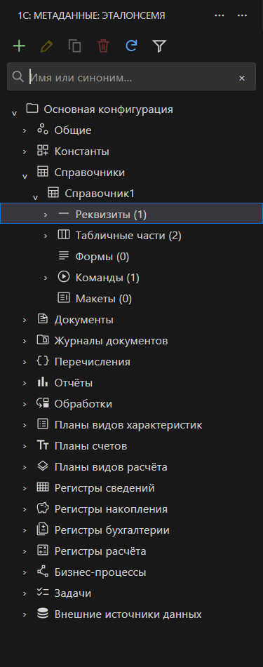
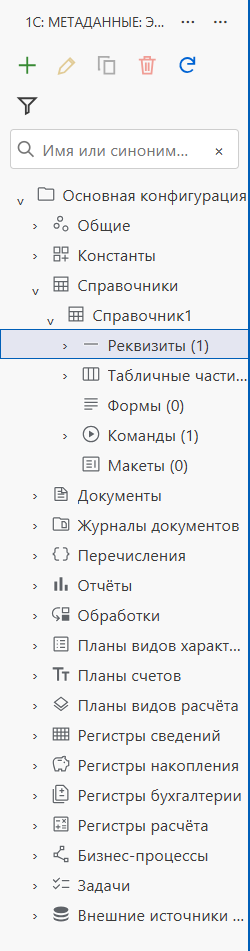
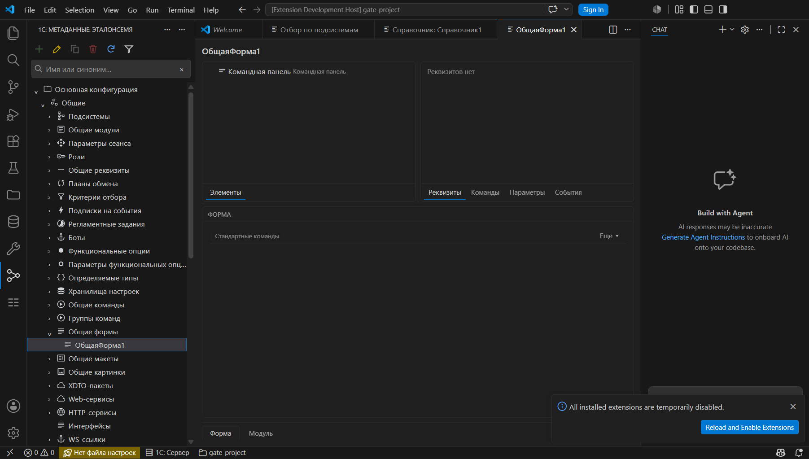
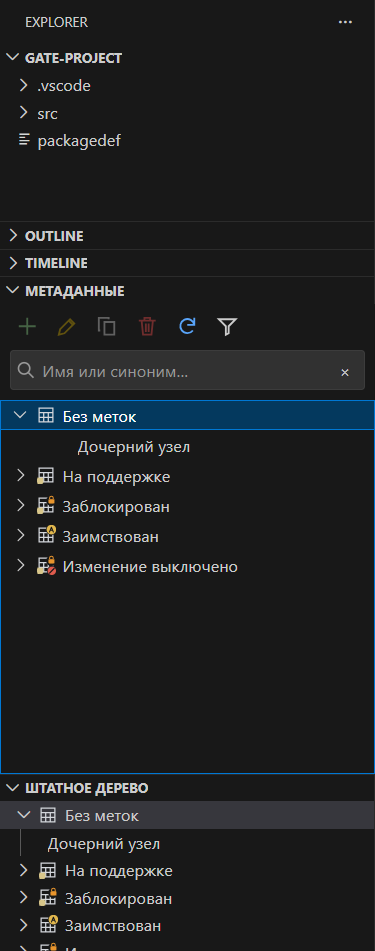

# Единый навигатор метаданных — PR #6

## Вертикальный gate до расширения UI

2026-10-31, VS Code 1.125.0, установленный md-sparrow 0.6.8, Java Temurin 25.
Реальные публичные XML: `yellow-hammer/samples-1c-platform` commit
`588acfd6effaee9e42cbb0584a43b32a33deb382`, базовый снимок
`snapshots/2.20/cf-bare-objects` + `cf-object-nodes` поверх него.
Рабочая копия и тестовое расширение находились в игнорируемом `build/`.

Gate **PASS** до полной замены contributions: отдельный WebviewView зарегистрирован
в настоящем Extension Host; прежний MetadataTreeDataProvider прочитал XML.
Проверена цепочка «Основная конфигурация → Справочники → Справочник1 →
Реквизиты (1), Табличные части (2), Формы (0), Команды (1), Макеты (0)».
DTO содержал штатные light/dark SVG URI. Первый запрос детей объекта вызвал
`getChildren` один раз; повторный запрос не читал их заново. Выбор передал прежний
MetadataLeafTreeItem существующему обработчику `metadata.copyObjectName`:
результат буфера обмена совпал с именем объекта, исходный буфер восстановлен.
После инвалидирования прежние ID/epoch отвергнуты. Ответ ограничен 100 строками.
Локальный машинный протокол: `build/navigator-gate.json`, журнал
`build/navigator-gate.log`; они не являются публикуемым артефактом PR.

Риск миграции локализован в renderer, протоколе выбора/reveal, контекстном меню
и жизненном цикле. Переписывать XML, модель дерева и предметные команды не нужно.
125.7 мс повторного refresh на маленьком снимке — диагностический замер,
не доказательство производительности большой конфигурации. Крупная конфигурация,
полный GUI-паритет и сравнение renderer на этом этапе **OPEN**.

## Реализация после gate

Регистрируется только `1c-platform-tools-metadata-tree` типа WebviewView.
Порт `MetadataTreeSelection` оставляет командам и палитре прежние TreeItem,
событие выбора и reveal. Сам `metadataTreeView.ts`, чтение md-sparrow, XML,
правила фильтрации и редакторы не менялись. Меню берётся из прежних contributions:
when разбирается без eval; клиент получает индекс разрешённого пункта, а не
идентификатор команды или аргументы. Клики проверяются по epoch/ID/версии выбора.

`getChildren` вызывается при раскрытии; параллельные запросы объединяются.
Транспорт отдаёт до 100 DTO; DOM рисует viewport с запасом шесть строк.
Дополнительные страницы доступны строкой «Показать ещё…». Reveal восстанавливает
только путь и нужные страницы, включая выбор после первой сотни.
Раскрытие/выбор хранятся в workspaceState отдельно по корню проекта.
При смене проекта selection немедленно сбрасывается, ответы прежнего epoch
отбрасываются. Поиск использует прежний `setTextFilter` и раскрывает результаты.

HTML использует nonce CSP и внешние ресурсы через asWebviewUri; названия узлов
и пунктов меню вставляются через textContent. Подсистемы открываются временным
WebviewPanel; сохранены мультивыбор, родители/потомки, сброс и признак отбора.
Входящие пути проверяются по прочитанному дереву, таймеры/подписки очищаются.

Настоящий заголовок — synonym/name из `cf-configuration-properties-get`.
Запоздалые результаты чтения имени после смены проекта не применяются.
В VS Code 1.125.0 workbench показывает одну строку «1С: Метаданные: ЭталонСемя»:
имя контейнера остаётся штатным префиксом. Публичного setter для него нет.
Дополнительного заголовка внутри HTML нет. Это ограничение визуального совпадения
с эталоном; картинка была получена в чате, а не в GitHub-комментарии.

## Проверено в настоящем VS Code

Windows, VS Code 1.125.0, тот же публичный XML-снимок. Production extension
активировано через `scripts/smoke-metadata-navigator.cjs`; реальные webview
проверялись через Chromium DevTools Protocol, без изменения пользовательского окна.

- Загрузка SVG, один view, отсутствие h1/h2 внутри webview, строка команд/поиск.
- Раскрытие справочника и его состава; стрелка вниз, aria-activedescendant,
  Shift+F10, меню «Добавить» на разделе реквизитов, Escape.
- Поиск «Справочник1» оставил только путь к результату; очистка вернула группы.
- Воронка открыла временную вкладку; флажок «Подсистема1», включение родителей,
  сброс отметки работают. Предметные тесты покрывают объединение нескольких
  подсистем и родители/потомки; полный ручной сценарий остаётся в приёмке.
- «Свойства» из меню открыло существующий редактор «Справочник: Справочник1».
  Клик по «ОбщаяФорма1» открыл прежний редактор формы. Палитра после сброса
  отбора показала выбранную «ОбщаяФорма1» и её свойства. Запись не выполнялась.
- Светлая/тёмная темы, ширина 200 px: кнопки переносятся, подписи сокращаются.
  Повторный запуск восстановил раскрытие; focus-ID старых views выполняются.

## Замеры и граница доказательства

На том же маленьком реальном снимке создан также прежний native TreeView с тем же
провайдером. После прогрева выполнены десять попарных reveal к одному объекту.
Измерено **только завершение API-вызова**, без ожидания отрисовки кадра:

| Renderer/адаптер | Медиана, мс | Максимум, мс |
| --- | ---: | ---: |
| native TreeView.reveal | 5.96 | 16.93 |
| Webview model.reveal | 4.28 | 63.23 |

Локальный протокол: `build/navigator-comparison.json`. В этом коротком прогоне
максимум нового адаптера выше; причины выброса и время paint не установлены.
Цифры не означают ускорения или отсутствия регрессии на большой конфигурации.
Отдельный тест 20 000 синтетических узлов подтверждает лимит DTO и ленивые чтения,
но не является замером GUI на реальной большой конфигурации.

**OPEN:** репрезентативная крупная конфигурация, cold start/память/frame-time и
полное сравнение renderer; ручной паритет записи свойств, форм/макетов,
расширений/поддержки, смена проекта с настоящими редакторами; другие ОС и форки.
Полная приёмочная готовность до этих проверок не объявляется.

## Автоматические проверки

`npm ci`, `npm run typecheck`, `npm run lint`, `npm run compile`, `npm test`,
`npm run package` — успешно. Локальный прогон первой реализации: **2054 passing / 6 pending**
Extension Host и **264 pass / 10 skipped** Node, без падений. Новые тесты проверяют
пагинацию, стабильные ID, stale replies, восстановление выбора после 200-й строки,
ограниченную маршрутизацию и негативные сообщения. Существующие тесты меню
выполняются через новый разборщик when. VSIX первой реализации: 244 файла, 6.21 MB.
Ссылка на Actions VSIX нового полного HEAD закрепляется в body существующего PR #6.
Formal review и merge не выполнялись.

## Исправление значков и шевронов по снимку Сергея

Сломанные изображения воспроизведены в настоящем VS Code 1.125.0.
`ExtensionContext.globalStorageUri` имеет схему `vscode-userdata:`, тогда как
прежний генератор наложений пишет SVG через fsPath и возвращает `Uri.file`.
Разрешённый localResourceRoot имел другую схему, поэтому webview блокировал
файлы кэша. Обычные SVG из resources продолжали загружаться.

Корень кэша теперь тоже строится через `Uri.file(...fsPath)`. Разрешён только
каталог `metadata-tree-icons`; всё хранилище и произвольные файлы не открываются.
Генератор наложений, содержимое SVG, дерево и предметные команды не менялись.

Символы `›`/`⌄` заменены оригинальными `chevron-right.svg`/`chevron-down.svg`
Microsoft Codicons из поставки VS Code — в навигаторе и отборе подсистем.
SVG не изменены; атрибуция и CC-BY-4.0 находятся в resources/webview/icons.
Шеврон меняется с раскрытием, цвет наследуется от строки.

В изолированном GUI-стенде проверены обычный значок, поддержка, замок,
заимствование и запрет изменения, обе SVG-темы: **до правки 2/10 файлов
загружались, после правки 10/10** (`complete=true`, `naturalWidth=16`).
Это синтетическая матрица значков с настоящим генератором и механизмом webview,
а не снимок корпоративной конфигурации. Проверены CSS-маски обоих шевронов,
раскрытие кликом и aria-expanded; ниже для сравнения показан native TreeView.
Регрессионный тест использует vscode-userdata storage и составные SVG, включая
путь с пробелами/кириллицей; проверяет схемы URI и ограничение разрешённого корня.
После исправления прошли typecheck, lint, compile и полный npm test:
**2055 passing / 6 pending** Extension Host, **264 pass / 10 skipped** Node.
`npm run package` также прошёл: новый VSIX содержит 248 файлов, 6.21 MB.

